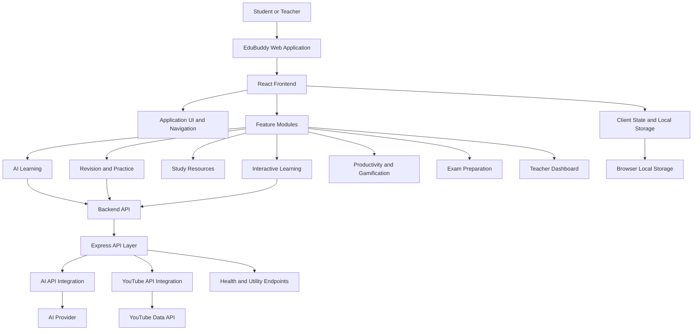
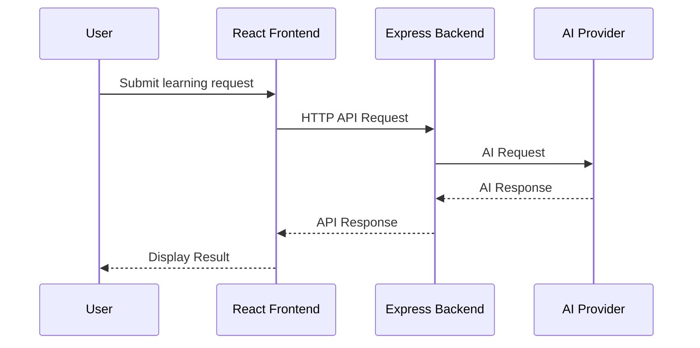

# EduBuddy

## An AI-Powered Learning Platform for Students

EduBuddy is an AI-powered educational platform designed to help students from Classes 1–12 learn concepts, practice questions, revise effectively, organize their studies and monitor their learning progress.

The idea behind EduBuddy is to bring multiple educational tools into a single platform rather than requiring students to switch between separate applications for notes, quizzes, revision, videos, study planning and productivity.

EduBuddy combines AI-assisted learning, interactive visualizations, study resources, productivity tools and gamification to create a more organized and engaging learning experience.

The project is being developed as part of a PS04 problem statement and is continuously evolving.

---

## Table of Contents

1. Project Overview
2. Problem Statement
3. Project Objectives
4. Features
   - AI Learning System
   - Learning and Revision Tools
   - Study Resources
   - Interactive Learning
   - Productivity and Gamification
   - Examination Preparation
   - Student and Teacher Accounts
5. System Architecture
6. Application Architecture
7. AI Integration
8. Data Storage and Persistence
9. Technology Stack
10. Project Structure
11. Installation and Setup
12. Environment Configuration
13. Running the Application
14. Building the Application
15. Deployment
16. Current Limitations
17. Future Scope

---

## 1. Project Overview

EduBuddy is a web-based educational assistant that provides students with tools to support different stages of learning.

The platform is designed around the idea that effective studying involves more than simply reading notes. Students need to understand concepts, practice what they have learned, identify mistakes, revisit difficult topics, access learning resources and manage their time.

EduBuddy attempts to support this entire process through a single application.

The platform currently includes an AI tutor, AI-generated study notes, quizzes, flashcards, revision recommendations, mistake tracking, interactive simulations, video learning, formula sheets, study resources, a focus timer, examination tracking and learning-related gamification.

The application also includes student and teacher account experiences.

---

## 2. Problem Statement

Students often rely on several different platforms and tools for their academic activities. They may use one application for video lectures, another for notes, another for quizzes, separate tools for time management and additional resources for revision.

This fragmentation can make studying less organized and may make it difficult for students to identify their weaknesses, track their progress and maintain consistency.

EduBuddy aims to address this by providing a unified educational platform where students can:

- Understand academic concepts with AI-assisted explanations.
- Generate and organize study material.
- Practice questions and evaluate their understanding.
- Identify and revisit mistakes.
- Revise topics based on their performance.
- Explore concepts through interactive visualizations.
- Find supplementary educational resources.
- Organize their study schedules.
- Monitor learning activity and progress.
- Maintain study consistency through productivity and motivational features.

---

## 3. Project Objectives

The primary objectives of EduBuddy are:

- To provide personalized, AI-assisted academic support.
- To simplify the process of generating study material and practice questions.
- To help students identify areas where they need improvement.
- To encourage active learning rather than passive reading.
- To provide interactive visual learning experiences for difficult concepts.
- To centralize educational resources and revision tools.
- To encourage consistent study habits.
- To provide a platform that can accommodate different academic levels from Classes 1–12.
- To create a modular educational application that can be expanded with additional features.

---

# 4. Features

## 4.1 AI Learning System

### Buddy AI — AI Tutor

Buddy AI serves as the conversational learning assistant within EduBuddy.

Students can ask academic questions, seek explanations, clarify concepts and interact with the AI to help them understand subjects and topics.

The AI interaction is designed to support students rather than simply provide answers. Students can use it as an additional learning resource when they encounter concepts they find difficult.

### Learn — AI Explanations and Notes

The Learn section allows students to select academic topics and obtain AI-assisted explanations and study notes.

It is designed to help students understand subjects through structured educational content.

The learning experience supports different explanation approaches, including simpler explanations and more detailed learning-oriented content.

Students can generate notes for selected topics and use the generated material as a study resource.

### Practice — AI Quiz Generator

The Practice section allows students to generate quizzes to test their understanding of academic topics.

The system generates questions, presents answer choices and evaluates the student's responses.

After answering, students can receive feedback and explanations to help them understand the concepts behind the questions.

Quiz performance can also contribute to other learning features, including progress tracking, Smart Revision and the Mistake Book.

### Study Planner

The Study Planner helps students organize their study activities and academic tasks.

Students can create and manage study tasks to organize their learning schedule and keep track of activities they intend to complete.

The planner is intended to help students structure their academic workload rather than relying entirely on unorganized study sessions.

### Flashcards

EduBuddy includes a flashcard-based learning system for revisiting important concepts.

Flashcards allow students to review information through a question-and-answer learning format, supporting active recall.

Flashcard sessions can also contribute to learning activity tracking and gamification.

---

## 4.2 Learning and Revision Tools

### Smart Revision

Smart Revision helps students identify topics that may require additional attention.

It uses available learning and quiz-related data to identify areas where the student may need to revise.

Topics can be categorized according to their learning status, including:

- Needs Attention
- Revisit
- Improving
- Strong

Students can review topic-specific refreshers and take targeted revision quizzes.

The feature is designed to make revision more focused by prioritizing topics instead of treating every subject and chapter equally.

### Mistake Book

The Mistake Book automatically records incorrect answers from supported quiz and revision activities.

It provides students with a dedicated space to revisit questions they previously answered incorrectly.

Recorded entries can include:

- Original question.
- Answer options.
- Selected answer.
- Correct answer.
- Explanation.
- Associated subject and topic.
- Source of the question.
- Date of the mistake.
- Number of occurrences.
- Retry history.
- Resolution status.

Students can retry questions, revisit unresolved mistakes, search and filter entries and mark mistakes as resolved when appropriate.

The feature is intended to encourage students to learn from errors rather than repeatedly overlook them.

### Subject and Topic Progress

EduBuddy includes progress-related functionality that uses learning activity to help students review their performance.

Quiz results and other supported activities contribute to progress-related information and learning feedback.

The application includes progress views and performance-related functionality, with additional analytics planned for future development.

---

## 4.3 Study Resources

### Video Learning Hub

The Video Learning Hub helps students discover supplementary educational videos and playlists.

The feature uses the YouTube Data API to retrieve relevant educational content based on academic context such as class, board, subject, topic or chapter.

Video results can be organized according to different discovery criteria, including:

- Best matches.
- Most viewed.
- Highest engagement.
- Recently uploaded.

Students can access video content, save useful resources and use available learning shortcuts to navigate to related study activities.

The feature also supports saving educational resources for later use.

### Reference Books and Question Banks

The Reference Books section provides students with recommendations for supplementary textbooks and question banks.

The resource catalog includes academic references across subjects and educational levels.

Students can explore recommendations, search and filter resources and save useful references.

The catalog includes references such as NCERT resources, supplementary textbooks and popular question banks.

The platform also provides links to selected official educational resources where available.

Book prices and availability may be approximate and should be verified independently.

### Formula Sheets

Formula Sheets provide a centralized collection of important academic formulas for supported subjects.

Students can browse formulas, search and filter content and save favorite formulas.

The feature is intended to help students quickly revisit important mathematical and scientific concepts without having to search through entire textbooks.

Formula entries include relevant mathematical expressions and supporting descriptions where available.

### Bookmarks and Saved Resources

The Bookmarks section provides a centralized location for saved learning resources.

Students can save supported resources and access them later without having to search for them again.

The feature integrates with supported resource-saving functionality within EduBuddy, allowing saved items to be organized and revisited.

---

## 4.4 Interactive Learning

### Visual Learning Studio

The Visual Learning Studio provides interactive visual experiences designed to help students understand concepts that may be difficult to learn through text alone.

It includes interactive simulations and visual learning experiences covering selected topics in science, mathematics and other educational areas.

The currently implemented visual experiences include:

- Solar System Explorer: Explore planetary motion and the arrangement of planets using a visual representation and interactive controls.
- Human Heart: Explore the chambers, vessels and blood circulation pathways of the human heart.
- Photosynthesis: Explore the processes and structures involved in photosynthesis, including the role of sunlight, water and carbon dioxide.
- Electric Circuit: Explore circuit behavior using interactive circuit elements and controls related to voltage and resistance.
- Reflection and Refraction: Explore optical behavior, light rays, reflection, refraction and relevant angle-based interactions.
- Atomic Structure: Explore atomic structures and electron arrangements using an interactive atomic model.
- Geometry Explorer: Explore geometrical shapes, dimensions and mathematical properties using interactive controls.
- Water Cycle: Explore the stages of the water cycle through an interactive visual experience.

The Visual Learning Studio includes guided and exploration-oriented modes for supported visual experiences.

Students can explore visualizations, interact with controls and access related learning activities.

Additional topics may also be explored through the supported AI-assisted visualization functionality and available fallback experiences.

---

## 4.5 Productivity and Gamification

### Pomodoro Focus Timer

The Pomodoro Focus Timer helps students organize focused study sessions using timed work and break periods.

The timer supports focus sessions, breaks, pause and resume functionality and session management.

The application tracks focus-related activity and provides session statistics.

Completed focus sessions can contribute to the platform's gamification system.

### XP, Levels and Streaks

EduBuddy includes a gamification system designed to encourage consistent learning activity.

Students can earn XP through supported educational activities such as quizzes, revision, flashcards, study tasks and completed focus sessions.

XP contributes to the student's level progression.

The platform also tracks study-related streaks through supported learning activities.

The gamification system is intended to provide motivation and encourage students to maintain consistent study habits.

### Daily Missions

Daily Missions provide students with learning-related activities that can be completed to earn additional XP.

Missions are designed around supported learning activities and encourage students to interact with different parts of EduBuddy.

Mission completion and rewards are tracked through the gamification system.

### Achievements

EduBuddy includes an achievement system that rewards supported learning milestones and activities.

Achievements are designed to recognize progress and encourage continued engagement with the platform.

### Daily Challenge

Daily Challenge provides students with a question-based learning activity.

Students can answer questions, receive feedback and explanations and review their performance after completing the challenge.

The feature supports challenge completion tracking and integrates with the application's reward system.

---

## 4.6 Examination Preparation

### Exam Countdown

Exam Countdown helps students organize and track upcoming examinations.

Students can create, edit, manage and monitor examinations.

The feature provides countdown information and examination-related organization.

Supported functionality includes:

- Creating examinations.
- Editing examination details.
- Removing examinations.
- Tracking upcoming examinations.
- Viewing urgent and approaching examinations.
- Managing examination completion.
- Maintaining syllabus checklists.
- Tracking syllabus preparation progress.
- Organizing examinations by subject.
- Viewing examination-related preparation information.

The feature is designed to help students plan their preparation and monitor how much of their syllabus they have completed.

---

## 4.7 Student and Teacher Accounts

### Student Accounts

EduBuddy supports student accounts with student-oriented application access.

Student accounts provide access to the learning platform and supported educational features.

Students can use the application to study, practice, revise, manage resources and track supported learning activities.

### Teacher Accounts

EduBuddy also includes a separate teacher-oriented account experience.

Teacher accounts are routed to the Teacher Dashboard, which provides a distinct interface designed for teacher-related functionality.

The current account system uses local browser-based persistence rather than a centralized cloud authentication service.

---

# 5. System Architecture

EduBuddy uses a frontend-backend architecture.

The frontend is responsible for the user interface, navigation, learning interactions, feature rendering and client-side state management.

The backend provides server-side API endpoints for AI interactions and external services.

The application uses local browser storage for supported account and learning data persistence.

## Architecture Overview



## Architectural Layers

### 5.1 Presentation Layer

The presentation layer is built using React and TypeScript.

It is responsible for:

- Rendering the user interface.
- Managing page navigation.
- Displaying dashboards and learning pages.
- Rendering interactive components.
- Handling user input.
- Managing UI states.
- Supporting responsive layouts.
- Supporting theme-related presentation.

### 5.2 Feature Layer

EduBuddy uses feature-oriented modules for many of its educational features.

These modules encapsulate functionality such as:

- Pomodoro.
- Formula Sheets.
- Daily Challenge.
- Exam Countdown.
- Reference Books.
- Bookmarks.
- Visual Learning Studio.
- Teacher Dashboard.
- Authentication.

Feature modules are intended to separate feature-specific components, types, logic and styles from the main application.

This structure makes individual features easier to develop, maintain and integrate.

### 5.3 Application Integration Layer

The main application integration layer connects individual features with the broader EduBuddy application.

It is responsible for coordinating:

- Navigation.
- Student application state.
- Feature integration.
- Shared application data.
- Dashboard shortcuts.
- Theme information.
- Shared learning-related functionality.
- Feature callbacks and interactions.

The main application entry and integration logic coordinate the different modules so that the application behaves as a unified platform.

### 5.4 Backend API Layer

The backend is implemented using Node.js and Express.

It provides server-side functionality for operations that require API access, including AI interactions and external service integration.

The backend is responsible for:

- Receiving frontend API requests.
- Processing AI-related requests.
- Communicating with configured AI providers.
- Returning structured or textual responses.
- Handling YouTube search requests.
- Providing health-related endpoint functionality.
- Managing server-side API configuration.
- Keeping API credentials out of the frontend.

### 5.5 External Services Layer

EduBuddy currently integrates with external services for selected functionality.

AI Provider:

Used for AI-assisted educational functionality, including explanations, notes, quiz generation and other supported AI tasks.

YouTube Data API:

Used by the Video Learning Hub to discover educational videos and playlists.

---

# 6. Application Architecture

## Frontend

The frontend is implemented using React, TypeScript and Vite.

The frontend provides the student and teacher interfaces and integrates the educational feature modules.

Frontend responsibilities include:

- Application navigation.
- Dashboard rendering.
- Feature integration.
- Authentication interfaces.
- Student learning interactions.
- Teacher-oriented interfaces.
- Client-side state management.
- Local persistence.
- AI request handling through backend endpoints.
- Responsive user interface.

## Backend

The backend is implemented using Express and Node.js.

The backend provides API endpoints that are consumed by the frontend.

The backend handles external API communication and server-side operations.

AI functionality is accessed through backend requests rather than directly exposing the API key in the frontend.

## API Communication

The frontend communicates with the backend using HTTP requests.

The backend processes requests and communicates with external services where required.

The general interaction flow is:



## Feature Module Design

EduBuddy uses a modular approach for several features.

A feature module may contain:

- React components.
- TypeScript types.
- Feature-specific state or hooks.
- CSS styles.
- Supporting logic.
- Integration exports.

This approach is intended to reduce coupling between individual features and improve maintainability.

---

# 7. AI Integration

EduBuddy uses an AI API integration to provide educational functionality.

The backend communicates with a configured AI provider using an OpenAI-compatible chat-completions interface.

The provider configuration is controlled through environment variables.

The AI integration supports different task types, depending on the feature requesting the service.

Supported AI functionality includes:

- Educational conversations through Buddy AI.
- Topic explanations.
- Study note generation.
- Quiz generation.
- Study planning.
- Flashcard generation.
- Smart Revision-related AI functionality.
- AI-assisted visual topic exploration.

Some AI tasks require structured responses.

For example, quiz generation, flashcards and other structured learning features may require the AI response to follow a specific JSON structure so that the frontend can process and display the generated content.

The backend processes AI requests and returns the results to the frontend.

The application also includes fallback or demo behavior when live AI configuration is unavailable.

Live AI functionality requires valid server-side API configuration.

---

# 8. Data Storage and Persistence

EduBuddy currently uses browser-based persistence for supported application data.

The application uses localStorage to persist selected data across browser reloads.

## Local Persistence

Supported application data may include:

- Student account information.
- Authentication-related local data.
- Student profile information.
- Learning progress.
- Quiz-related data.
- Saved resources.
- Revision-related data.
- Mistake Book entries.
- Gamification progress.
- Pomodoro-related data.
- Examination information.
- Feature-specific saved data.

Different features may use separate persistence keys or feature-specific storage mechanisms.

The application currently does not use a centralized cloud database for synchronizing all student learning data.

## Authentication Storage

The current account system uses local browser-based authentication-related persistence.

Password handling in the local authentication implementation uses salted PBKDF2-SHA-256 hashes rather than storing passwords as plaintext.

This is a local account implementation and is not equivalent to a production-grade centralized authentication service.

## Data Limitations

Because data is stored locally:

- Data is generally tied to the browser and device.
- Accounts are not automatically synchronized across devices.
- Clearing browser storage may remove locally stored data.
- Different devices may not share the same learning history.
- The current system is not designed for centralized school-wide student management.

---

# 9. Technology Stack

| Technology | Purpose |
|---|---|
| React | Frontend UI development |
| TypeScript | Type-safe frontend and backend development |
| Vite | Frontend development server and build tooling |
| Node.js | Backend runtime |
| Express | Backend API framework |
| JavaScript and TypeScript | Application logic |
| localStorage | Browser-based persistence |
| AI API | AI-powered learning functionality |
| YouTube Data API | Educational video discovery |
| PDFMake | PDF notes generation |
| Marked | Markdown processing |
| Three.js | Interactive 3D visualization functionality |
| Lucide | Application icons |
| Git | Version control |
| GitHub | Source code repository |

---

# 10. Project Structure

The project follows a frontend application structure with backend API functionality.

The structure below represents the major areas of the application. Individual files may vary as development continues.

```text
EduBuddy/
│
├── src/
│   │
│   ├── App.tsx
│   ├── styles.css
│   ├── pdfExport.ts
│   │
│   ├── features/
│   │   │
│   │   ├── auth/
│   │   │
│   │   ├── daily-challenge/
│   │   │
│   │   ├── daily-quote/
│   │   │
│   │   ├── exam-countdown/
│   │   │
│   │   ├── reference-books/
│   │   │
│   │   ├── teacher-dashboard/
│   │   │
│   │   ├── formula-sheets/
│   │   │
│   │   ├── bookmarks/
│   │   │
│   │   ├── subject-analytics/
│   │   │
│   │   └── other feature modules/
│   │
│   ├── visuals/
│   │
│   └── supporting frontend modules/
│
├── server.ts
├── package.json
├── tsconfig.json
├── tsconfig.server.json
├── render.yaml
├── .env.example
├── .gitignore
└── README.md
```

### Important Files

`App.tsx`

Main frontend application integration point responsible for integrating application pages, navigation, shared state and supported feature functionality.

`styles.css`

Contains application-level styling and shared presentation styles.

`server.ts`

Backend server entry point containing Express API functionality and integrations.

`pdfExport.ts`

Contains functionality related to generating and exporting learning notes as PDF documents.

`package.json`

Contains project dependencies and development, build and other project scripts.

`tsconfig.json`

Frontend TypeScript configuration.

`tsconfig.server.json`

Backend TypeScript configuration.

`.env.example`

Provides a template for the environment variables required by the application.

`render.yaml`

Contains existing Render deployment configuration.

---

# 11. Installation and Setup

## Prerequisites

Before installing EduBuddy, ensure that you have the following installed:

- Node.js version 20 or newer.
- npm.
- Git.
- A code editor such as Visual Studio Code.

## Clone the Repository

```bash
git clone https://github.com/deva3435/EduBuddy.git
```

Navigate into the project directory:

```bash
cd EduBuddy
```

## Install Dependencies

```bash
npm install
```

This installs the dependencies required by the frontend and backend.

---

# 12. Environment Configuration

EduBuddy uses environment variables for external API configuration.

Create a `.env` file in the root directory of the project.

The `.env` file should contain the required configuration.

Example:

```env
OPENAI_API_KEY=your_ai_api_key
OPENAI_MODEL=gemini-2.5-flash
OPENAI_BASE_URL=https://generativelanguage.googleapis.com/v1beta/openai/chat/completions

YOUTUBE_API_KEY=your_youtube_api_key

PORT=3001
```

### Environment Variable Description

| Variable | Description |
|---|---|
| `OPENAI_API_KEY` | API key for the configured AI provider |
| `OPENAI_MODEL` | AI model used for AI requests |
| `OPENAI_BASE_URL` | AI API endpoint |
| `YOUTUBE_API_KEY` | API key used for YouTube Data API integration |
| `PORT` | Backend port used where applicable |

The AI configuration shown above is intended for the Gemini OpenAI-compatible API interface.

The YouTube API key is required for live Video Learning Hub search functionality.

Do not commit the actual `.env` file to GitHub.

Do not expose API keys in frontend code.

---

# 13. Running the Application

Start the development environment using:

```bash
npm run dev
```

The development environment runs the frontend and backend according to the project's development scripts.

The frontend is generally accessible at:

```text
http://localhost:5173
```

The backend is generally accessible at:

```text
http://localhost:3001
```

The actual ports may depend on the project's configuration.

---

# 14. Building the Application

To run the production build:

```bash
npm run build
```

The build process performs the configured TypeScript checks and builds the frontend application.

The generated frontend production assets are produced by Vite.

---

# 15. Deployment

EduBuddy is being prepared for deployment using a cloud hosting platform.

The project currently includes an existing Render configuration and is also being prepared for Vercel deployment.

Deployment requires the frontend and backend API functionality to be correctly configured for the hosting environment.

The AI and YouTube API keys must be configured through the hosting provider's environment variable settings.

A successful deployment should ensure that:

- The frontend is accessible publicly.
- API requests reach the correct backend endpoints.
- AI functionality operates using server-side API configuration.
- YouTube search functionality is available when configured.
- Secrets are not exposed publicly.
- Frontend routing works correctly.

Deployment architecture and configuration may evolve as the project progresses.

---

# 16. Current Limitations

EduBuddy is actively being developed. The following limitations apply to the current implementation:

### Local Data Persistence

The application currently uses local browser storage for supported account and learning data.

Data is not automatically synchronized across devices.

### Authentication

The current authentication system is browser-based and is intended for the project's current implementation.

It does not currently provide centralized cloud authentication or a production-grade account management infrastructure.

### AI Availability

Live AI features require appropriate API configuration.

Without valid configuration, some AI functionality may use fallback or demo responses.

AI-generated content may occasionally be inaccurate and should be reviewed.

### External Resources

Video content and certain external resources depend on third-party services.

Availability, content and API functionality may change independently of EduBuddy.

### Feature Development

Some features may continue to undergo improvements, integration testing, UI refinement and performance optimization.

---

# 17. Future Scope

EduBuddy is intended to continue evolving.

Potential future improvements include:

- Advanced subject-wise analytics.
- Expanded examination preparation tools.
- Previous Year Question Paper integration.
- Topic-wise question analysis.
- Adaptive learning recommendations.
- Improved teacher functionality.
- Cloud-based account and data synchronization.
- More interactive simulations.
- Additional educational resource integrations.
- Improved deployment and reliability.
- Additional accessibility improvements.
- Expanded learning personalization.

These improvements are part of the ongoing development roadmap and are not necessarily implemented in the current version.

---

## Project Status

EduBuddy is an actively developed educational platform created as part of a PS04 problem statement.

The project focuses on combining AI-assisted learning, revision tools, educational resources, interactive learning, productivity and progress-related functionality into one application.

The platform continues to undergo development, testing, integration and improvement.

---

## Repository

GitHub: https://github.com/deva3435/EduBuddy

---

EduBuddy is built as an ongoing learning and development project with the goal of making studying more organized, interactive and approachable.
